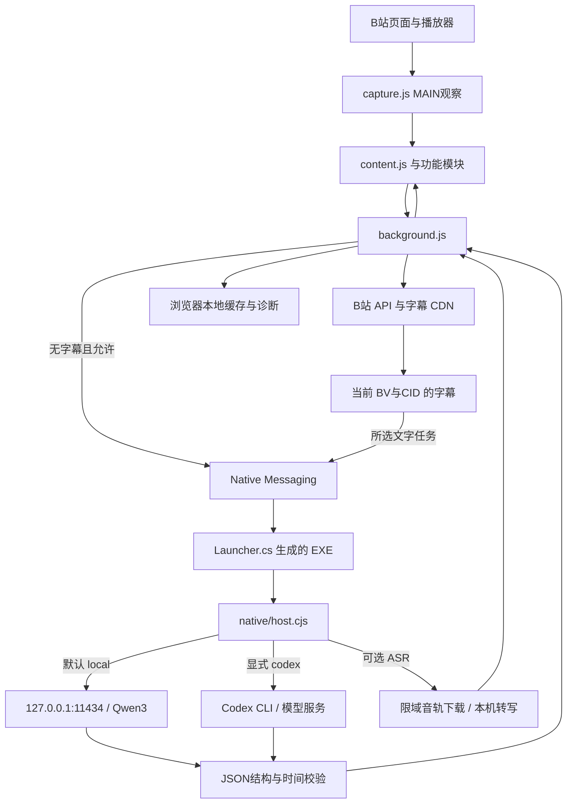

# 架构与维护说明 · 3.0.3 Public Beta

小电视助手 · BiliPlus 是 Chrome Manifest V3 扩展，使用原生 HTML/CSS/JS。倍速、布局、历史与净化在内容脚本中完成。字幕分析通过 Windows Native Messaging 桥接，默认调用本机 Ollama；Codex CLI 为显式可选。ASR 是单独安装的 Python/faster-whisper 环境。

## 数据链路

读取和导出已有字幕不调用模型。默认文本分析仅发往固定本机 Ollama 地址，模型安装/下载仍需网络。选择 Codex 时字幕会交给其模型服务；本机失败不会自动回退 Codex。

音频转写与文字服务选择独立：`transcribe` 始终分派到本机 ASR，下载的音频不会交给 Codex。其后可把文字交给所选服务分析。

## 模块职责

| 路径                                               | 职责                                                                     |
| -------------------------------------------------- | ------------------------------------------------------------------------ |
| `extension/manifest.json`                          | 固定扩展身份、权限、内容脚本顺序与入口                                   |
| `extension/capture.js`                             | MAIN 环境观察当前视频、字幕、推荐与公开评论响应；保留原生 fetch/XHR 行为 |
| `extension/content.js`、`panel.css`                | 右栏嵌入字幕助手、默认字幕页、内部滚动、高度调节、结果与任务状态         |
| `extension/background.js`                          | 消息来源校验、B站请求、字幕/分析缓存、原生端口、模型准备进度与取消       |
| `extension/subtitles.js`                           | 字幕轨道、二进制元数据、WBI、URL与时间规范                               |
| `extension/common/config.js`、`settings-fields.js` | 设置默认值、校验、备份、过滤规则与界面字段                               |
| `extension/common/ui.js`                           | 主题、内置每日文字、本地背景校验及缩放                                   |
| `extension/features/runtime.js`、`index.js`        | Scope 清理、路由与设置变化、功能启动/重建                                |
| `extension/features/player.js`                     | 原生倍速菜单、快捷键、全屏进度、公开评论属地                             |
| `extension/features/layout.js`                     | 独立右侧评论、宽度调节、节点移动及还原                                  |
| `extension/features/home.js`                       | 推荐历史、封面、悬停预览、加载优化、极简首页                             |
| `extension/features/filter.js`                     | 卡片过滤、逐项净化、连续空批次保护                                       |
| `extension/popup.*`、`options.*`                   | 快捷开关、完整设置、模型准备、导入导出与诊断                             |
| `native/Launcher.cs`                               | 无窗口启动器源码，启动 Node并转发原生消息字节流                          |
| `native/RuntimeHost.cs`、`runtime-start.cjs`          | Windows 模型服务宿主；通过无窗口控制台启动服务，桥接退出后保持运行       |
| `native/host.cjs`                                  | 分帧、任务分派、状态、取消、最近任务元数据                               |
| `native/local-summary.cjs`                         | 独立全文概要与章节任务、占位重试、原字幕摘录、字幕编号到实际时间映射      |
| `native/runner.cjs`、`tasks.cjs`、`*.schema.json`  | 任务输入/输出校验；所选 provider 路由；可选 Codex 进程                   |
| `native/local-model.cjs`、`setup-local.cjs`        | Ollama 检查/安装/启动、模型下载、本机生成与命令行准备                    |
| `native/asr.cjs`、`asr.py`、`setup_asr.py`         | 限域音轨、语音环境、模型加载、转写与清理                                 |
| `scripts/bootstrap-node.ps1`                       | 复用 Node 或官方 Node24 ZIP 校验与有界解压                               |
| `scripts/`、`tests/`                               | 检查、构建、源码打包与行为/协议/隔离安装测试                             |
| `.runtime/`                                        | 本机运行时、ASR配置、缓存与临时文件，不进入源码分发                      |

## 安装与身份

桥接主机兼容名称仍为 `local.bilibili_codex`，固定扩展 ID 保持原值以便已有安装更新。品牌名变更不改变该技术标识。安装器检查当前用户注册表的 32/64 位视图，只允许注册本目录的 manifest；其他目录持有同名主机时停止。

安装器必须由用户手动运行。系统 Node可用则复用；否则只从官方 nodejs.org 的 Node24 分发目录下载 ZIP，校验同目录 SHA256，再检查全部 ZIP 路径、链接与解压上限后写入 `.runtime/node`。不修改系统 PATH。系统编译器将 Launcher.cs 构建为本机 EXE，配置和绝对路径在接收机器生成。

默认随后准备 Qwen3:4b。缺少 Ollama 时，从受限官方下载路径取得安装器，验证 Windows Authenticode 为 Valid、签名发布者含 Ollama，再执行当前用户安装。模型拉取采用流式进度，可取消。已有运行时/模型复用；不修改用户 Ollama 环境变量、不删除用户模型。Chrome 的 unpacked 加载步骤仍由用户完成。

## 协议与生命周期

Chrome 按需启动启动器，启动器读取本机 Node 路径并运行 host.cjs；消息为四字节小端长度和 UTF-8 JSON，单帧最多 1MiB。主机校验扩展 origin，每个连接只处理一个活动任务。

状态、文字任务、转写与本机模型准备经原生连接分派。设置页的 `bili-model-setup` 端口协议见 [MODEL-SETUP-UI.md](MODEL-SETUP-UI.md)。取消、端口断开、切换视频或离开播放路由会传递 AbortSignal，终止对应处理并清理本次临时文件。Node 桥接没有另设 HTTP 监听；Ollama 使用自己的本机服务。

Windows 下，`runtime-start.cjs` 仅将 GUI 子系统的 `RuntimeHost.exe` 作为独立后台进程。宿主以 `UseShellExecute=false / CreateNoWindow=true` 启动 `ollama serve`，避免将 `DETACHED_PROCESS` 与 `CREATE_NO_WINDOW` 同时用于模型服务，导致后续模型子进程重新创建可见控制台。就绪前发送 `cancel` 只停止宿主刚创建的服务；就绪后关闭控制管道表示交接，宿主与服务继续运行。已有健康 Ollama 服务直接复用。两个 GUI 程序均由安装器编译后才发布到本机目录，源码包只包含源码。

## 输入、模型与输出边界

| 层           | 当前边界                                                                                               |
| ------------ | ------------------------------------------------------------------------------------------------------ |
| 视频身份     | BV/CID 与当前分 P核对；身份变化清空本页结果/会话并取消旧任务                                           |
| 通用字幕输入 | 最多 30,000 条；序列化不超过 200,000 字符；逐项检查时间和视频时长                                      |
| 本机文字模型 | 完整 prompt UTF-8总量≤28,000 字节，含系统/任务提示词、标题、字幕、问题与历史；超限明确拒绝，不静默截断 |
| 本机模型输出 | 固定 JSON Schema，关闭思考/工具调用，检查生成结束、JSON结构和任务时间范围；不完整结果报错              |
| 模型选择     | local/codex严格枚举；本机仅允许 qwen3:1.7b、qwen3:4b、qwen3:8b，默认4b                                 |
| 生成超时     | 默认5分钟；模型准备另有最长30分钟范围                                                                  |
| ASR          | 单分P≤2小时，音轨≤512MiB，下载与转写总计≤30分钟；仍受账号可播放权限限制                                |

28,000 是字节上限，不能与通用字符上限或模型标称上下文长度混为一谈。当前不自动分块长字幕。Qwen3:4b为约4B参数/Q4_K_M，模型下载约2.5GB；该大小不是运行内存需求。

本机模型输入中的字幕等被当成不可信材料，不提供工具执行或文件访问能力；可选 Codex 使用独立进程及受限模式。结果显示使用纯文本，输出结构和时间校验不等于内容准确性保证。

`native/local-summary.cjs` 为本机总结构造字幕编号 Schema。模型仅选择真实且位于视频内的 `startIndex`，程序映射对应字幕起点，排序并合并同起点主题；结束时间取下一主题起点或视频时长。合并保留完整主题和说明，超限明确拒绝，最终仍通过通用时间校验。其他文字任务和 Codex 协议保持原时间字段。

## 页面兼容与存储

观察原生 fetch/XHR的异常不得阻断页面请求。助手在原生右栏就绪后嵌入正常文档流；不使用浮动弹窗兜底。面板高度可调360–1600px，默认按视口限制到360–600px，下方留16px间距，列表/结果内部滚动。

推荐历史记录真正展示的顶部卡片，在受控作用域恢复，不按API顺序猜测；后台推荐加载不得抢回历史预览。仅播放身份变化或相关配置变化重启模块，主题、分组折叠等设置不清空首页历史。公开属地优先匹配评论ID，歧义或字段缺失不推测。

Scope 管理插入节点、监听、定时器和移动节点原位置；关闭功能需清理并还原。用户背景、配置、缓存和近期诊断在本机保存。缓存写入使用预算与淘汰；空间不足不丢弃已返回的结果。配置导入先校验全部候选数据，再更新内部状态，非法背景不能半导入设置。

## 测试与分发

`npm test` 包含协议、校验、取消、缓存、模拟DOM、模型HTTP/进程替身和真实PowerShell隔离安装测试。已有四类文字任务通过真实 Windows EXE/Node/Ollama 与合成中文字幕验证；它不等于真实Chrome页面操作，也不证明无Node/无Ollama新机安装。

构建保留可读源码；公开源码分发使用 `scripts/source-files.cjs` 白名单，排除运行环境、机器路径配置、已编译启动器、模型、原插件包、派生切片和个人验收日志。现有机器的桥接重装已通过，Public Beta仍需干净机器完整安装、实际Chrome功能组合、无字幕自动回退和多种页面变体的持续验收，见 [测试与发布说明](RELEASE-TESTS.md)。
